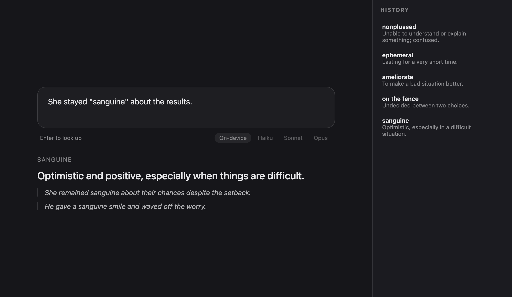
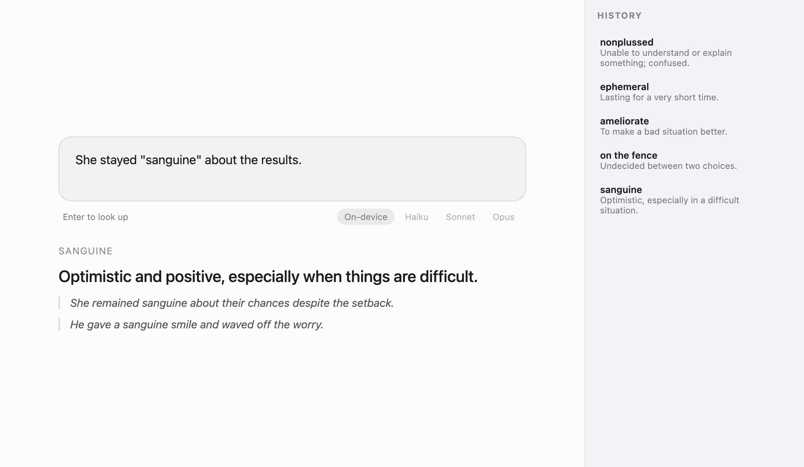
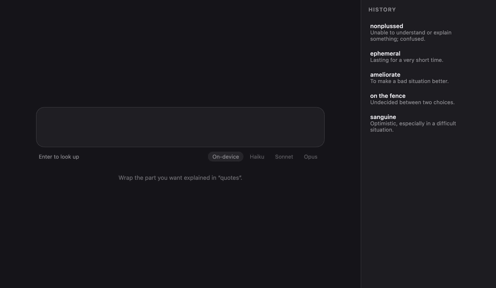

# BB Semantic Dictionary

A tiny dictionary plugin for [BB](https://getbb.app). Type a sentence and put the part you don't understand in quotes:

> He was "nonplussed" by the news.

You get a short meaning of that part *as used in your sentence*, plus two examples. Everything you look up is remembered in a **History** list in the sidebar (click an entry to reopen it, × to remove it).

- One text box, centered, with smooth animations
- Runs on your Mac's **on-device Apple model** by default: free, private, offline
- A 🔊 button next to the word reads it aloud with macOS's built-in on-device voice
- If Apple's safety filter refuses a sentence (slang, profanity), it automatically retries with Haiku through Claude Code
- Switch model with the chips under the box: On-device, Haiku, Sonnet, Opus (the last three go through your local [Claude Code](https://claude.com/claude-code) install, no API key needed)
- Any other alias or model ID can be set in Settings → Plugins → Lookup → Model

## Screenshots

Dark, with the History tab on the right:



Light:



Empty state:



> These are renders of the plugin's own markup and CSS with sample data, not captures of the live BB window.

## Requirements

- BB with plugin support
- macOS 26+ with Apple Intelligence enabled (for the on-device model)
- Xcode command line tools (`swiftc`) to build the helper
- Claude Code on your `PATH` at `~/.local/bin/claude` (only for the Haiku/Sonnet/Opus chips)

## Install

```sh
git clone https://github.com/pmzi/BB-semantic-dictionary.git
cd BB-semantic-dictionary
npm install --include=dev --ignore-scripts
swiftc -O native/main.swift -o bin/applelm   # builds the on-device helper
bb plugin install .
```

Then open **Lookup** in the BB sidebar.

## How it works

- `server.ts`: RPC handlers, history storage (`bb.storage.kv`, last 200 lookups), and the model runners
- `native/main.swift`: small Swift CLI that calls Apple's `FoundationModels` with guided generation and prints JSON
- `app.tsx`: the centered lookup page and the History tab
